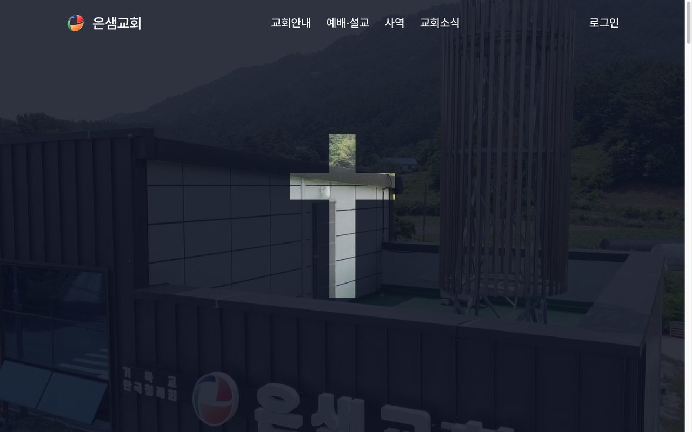
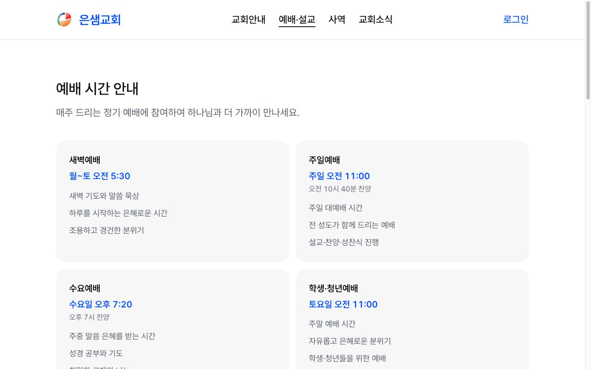
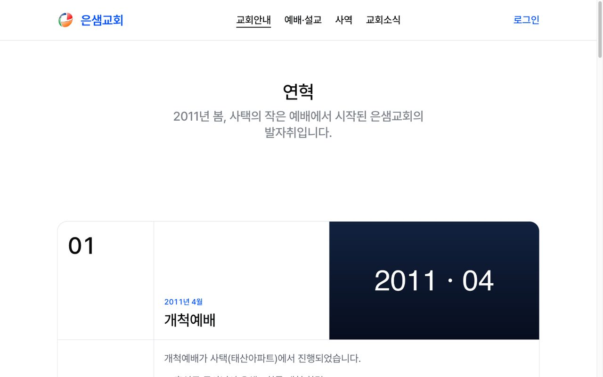
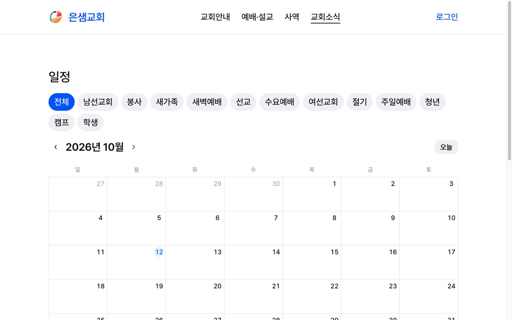

<div align="center">

<h1>은샘교회 웹사이트</h1>

기독교 한국침례회 은샘교회 홈페이지의 프론트엔드 — 다른 교회에도 다시 쓸 수 있는 교회 홈페이지 템플릿

**[www.eunsaem.com](https://www.eunsaem.com)** · 백엔드 레포 [church-template/church-backend](https://github.com/church-template/church-backend)


</div>

| 홈 | 예배 시간 안내 |
|---|---|
|  |  |
| **연혁** | **일정** |
|  |  |

## 무엇을 하나

**누구나 보는 공개 페이지**

- 교회안내: 소개 및 비전, 연혁, 목회자 인사말, 교회 사진, 연락처 및 위치(문의하기 폼 포함)
- 예배 시간, 부서(학생부·청년부·예배부·남선교회·여선교회) 페이지
- 공지, 일정(태그 필터가 있는 월간 캘린더), 주보

**회원 전용**

- 설교: 교인 승인 후 열람. 홈 화면의 최신 설교 카드는 제목·설교자·날짜만 보여 주고 로그인·승인으로 안내
- 갤러리(앨범)
- 성경 통독 챌린지: 66권 1,189장 구조를 상수로 두고 읽음 기록·소급·연속 기록 계산
- 차량 탑승 신청: 현재 위치 좌표를 첨부하고 카카오맵 링크로 확인
- 회원가입(약관 동의)·로그인·마이페이지

**관리자 화면** (`/mypage/manage`, 권한에 따라 노출)

- 회원, 역할·권한, 직분, 태그, 부서, 미디어 라이브러리, 문의, 통독 챌린지, 차량 운행 관리
- 설교·공지·일정·갤러리·주보 등록·수정은 모달이 아닌 전용 페이지 폼

**그 밖에**

- 홈 화면 설치(PWA 매니페스트), 사이트맵·robots·RSS·구조화 데이터(JSON-LD)
- 백엔드 장애 시 홈 화면 전체가 아니라 해당 영역만 실패하도록 격리

## 특징

- **템플릿 구조**: 환경마다 다른 값은 `.env`의 `NEXT_PUBLIC_API_BASE` 하나뿐이고, 교회 이름·도메인·소개문·히어로 같은 교회 고유값과 콘텐츠는 `src/constants/`에 모았습니다. 컴포넌트에 문자열을 직접 쓰지 않습니다.
- **데이터 패칭 경계**: 공개 페이지는 서버 컴포넌트 `fetch` + ISR, 회원·관리자 영역은 클라이언트에서 TanStack Query + `authFetch`로 불러옵니다.
- **권한 기반 UI**: 화면 노출은 직분이나 역할 이름이 아니라 백엔드가 내려 주는 `permissions` 문자열로 판단합니다.
- **디자인 시스템**: 색·타이포·간격은 [DESIGN.md](.claude/rules/DESIGN.md) 토큰으로만 씁니다. Button·Card 같은 시각 컴포넌트는 직접 구현했고, Modal·Popover 같은 동작 컴포넌트는 Radix 기반으로 재스킨했습니다. 고령 교인을 위해 글자와 UI 크기를 키웠습니다.
- **본문 렌더링**: 서버는 마크다운 원문을 저장하고, 프론트가 `marked` + DOMPurify로 변환·정화합니다. 본문 속 `media:{id}`는 미디어 API 주소로 바꿉니다.

## 기술 스택

| 구분 | 사용 기술 |
|---|---|
| 프레임워크 | Next.js 16 (App Router), React 19, TypeScript |
| 스타일 | Tailwind CSS 4, lucide-react 아이콘 |
| 상태·데이터 | TanStack Query(회원 영역), Zustand(토큰·회원 스냅샷) |
| 폼 | react-hook-form + zod |
| UI 동작 | Radix UI(Dialog·Dropdown·Popover·Select·Tabs), sonner(토스트) |
| 콘텐츠 | marked, isomorphic-dompurify |
| 테스트 | Vitest, Testing Library, jsdom |
| 배포 | Vercel (Node 22), GitHub Actions |

## 시작하기

Node 22와 pnpm이 필요합니다. 백엔드는 [church-backend](https://github.com/church-template/church-backend)의 안내대로 로컬에서 먼저 띄웁니다.

```bash
pnpm install
cp .env.example .env   # NEXT_PUBLIC_API_BASE에 백엔드 주소 지정
pnpm dev               # http://localhost:3000
```

| 명령 | 설명 |
|---|---|
| `pnpm dev` | 개발 서버 |
| `pnpm build` / `pnpm start` | 프로덕션 빌드 / 실행 |
| `pnpm lint` | ESLint |
| `pnpm test` / `pnpm test:watch` | Vitest |

`.env.example`의 변수는 `NEXT_PUBLIC_API_BASE`(필수, 빌드 시점에 인라인됨)와 검색엔진 소유 확인용 `GOOGLE_SITE_VERIFICATION`·`NAVER_SITE_VERIFICATION`(선택)입니다.

## 구조

```
src/
├── app/
│   ├── (site)/        # 교회안내·예배·설교·소식·갤러리·통독·차량·마이페이지(관리자 포함)
│   ├── (auth)/        # 로그인·회원가입·약관 동의
│   ├── departments/   # 부서 페이지
│   └── sitemap.ts · robots.ts · manifest.ts · rss.xml/
├── components/        # 도메인별 컴포넌트, ui/(시각 컴포넌트), admin/(관리자 화면)
├── constants/         # 교회 고유값·콘텐츠·내비게이션·권한·성경 구조
├── hero/              # 메인 히어로
└── lib/               # api·auth·hooks 등
```

## 배포

`deploy` 브랜치로 PR을 열면 자동으로 squash 머지되고, 그 push가 GitHub Actions에서 `vercel build` → `vercel deploy --prebuilt --prod`를 실행해 Vercel 프로덕션에 배포합니다. 런타임과 빌드 환경 모두 Node 22로 고정했습니다. 버전·CHANGELOG와 아래 버전 표기는 워크플로우가 관리합니다.

## 개발 규약 (요약)

자세한 규칙은 [`CLAUDE.md`](CLAUDE.md) · [`docs/church-frontend-guide.md`](docs/church-frontend-guide.md) · [`.claude/rules/DESIGN.md`](.claude/rules/DESIGN.md) 참조.

**데이터 패칭 경계** (가이드 15.1)

- 공개 페이지(메인·공지·일정·부서·주보): **서버 컴포넌트 `fetch` + ISR**. TanStack Query 미사용.
- 회원·어드민(설교·갤러리·통독·차량·내 정보): **클라이언트 + TanStack Query + `authFetch`**.
- 클라 상태는 Zustand(토큰·member 스냅샷), 폼은 react-hook-form + zod. 서버 데이터를 Zustand에 복제하지 않는다.

**설정 분리**

- 환경마다 다른 값만 `.env`(`NEXT_PUBLIC_API_BASE`). 교회 고유값·콘텐츠는 `src/constants/`(매직스트링 금지, env 아님).
- 색·간격·타이포는 DESIGN.md 토큰 참조(hex·px 인라인 금지).

> 이 프로젝트는 Next.js 16 — 코드 작성 전 `node_modules/next/dist/docs/`를 확인한다([AGENTS.md](AGENTS.md)).

## 문서

| 문서 | 내용 |
|---|---|
| [docs/church-frontend-guide.md](docs/church-frontend-guide.md) | 동작·연동 가이드(인증·인가·에러·렌더·미디어·확정 스택) |
| [docs/api-docs.json](docs/api-docs.json) | 백엔드 OpenAPI 스키마 |
| [.claude/rules/DESIGN.md](.claude/rules/DESIGN.md) | 디자인 시스템(토큰·컴포넌트 규칙) |
| [docs/seo-operations.md](docs/seo-operations.md) | 검색엔진 등록·운영 절차 |
| [docs/superpowers/specs/](docs/superpowers/specs/) · [plans/](docs/superpowers/plans/) | 기능별 설계·구현 계획 |
| [CLAUDE.md](CLAUDE.md) · [AGENTS.md](AGENTS.md) | 개발자·AI 에이전트 진입 문서 |

## 만든 사람

홍의민 · [EM-H20](https://github.com/EM-H20). 백엔드와 프론트엔드를 혼자 설계·구현했습니다.

## License

[MIT](LICENSE)

---

<!-- AUTO-VERSION-SECTION: DO NOT EDIT MANUALLY -->
## 최신 버전 : v0.1.80 (2026-09-20)

[전체 버전 기록 보기](CHANGELOG.md)
